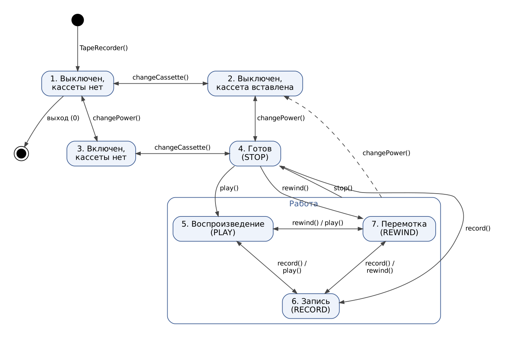
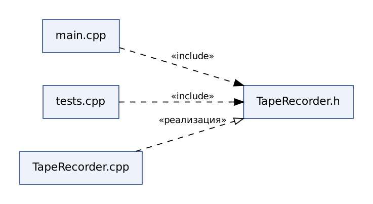
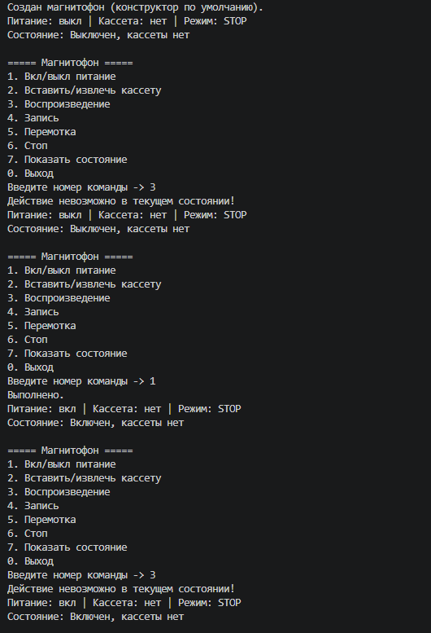
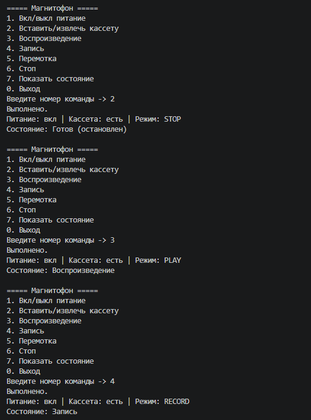
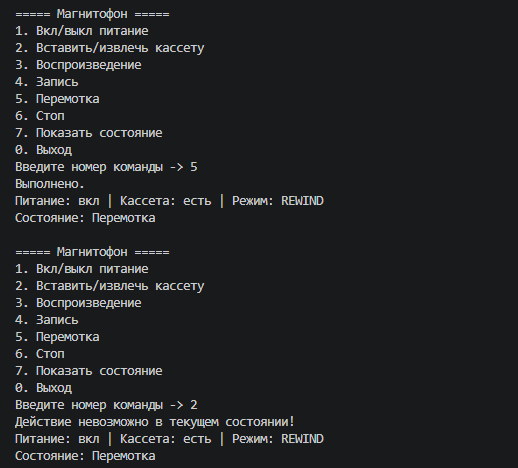
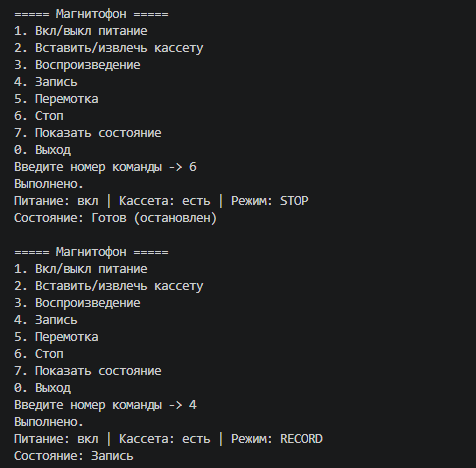
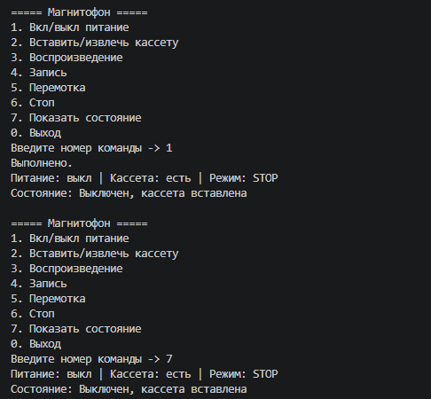
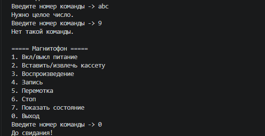
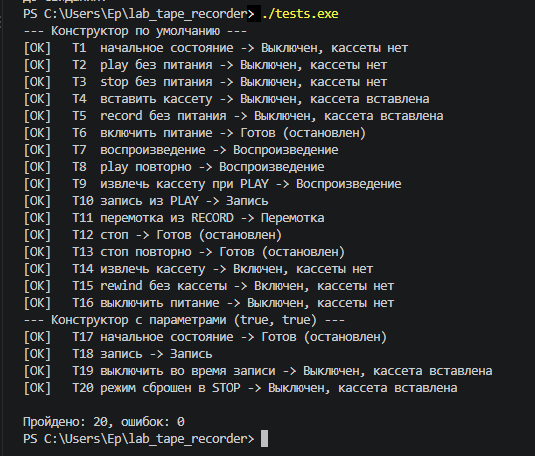

# Моделирование устройства с помощью класса — вариант 17 «Магнитофон»

Исполнители: Петроченко Д., Стекачев И., Заровнятных Д. (ИКТГ-2521)

Файлы:
- `TapeRecorder.h`, `TapeRecorder.cpp` — класс магнитофона;
- `main.cpp` — консольное меню для управления объектом;
- `tests.cpp` — тесты переходов между состояниями;
- `demo.mp4` — запись работы программы.

Сборка и запуск:
```
g++ main.cpp TapeRecorder.cpp -o lab.exe
./lab.exe
g++ tests.cpp TapeRecorder.cpp -o tests.exe
./tests.exe
```

## Модель

| Свойство | Тип | Значения |
|---|---|---|
| power | bool | вкл / выкл |
| cassette | bool | есть / нет |
| mode | enum | STOP, PLAY, RECORD, REWIND |

Методы: `changePower()`, `changeCassette()`, `play()`, `record()`, `rewind()`, `stop()`.

| # | Питание | Кассета | Режим | Состояние |
|---|---|---|---|---|
| 1 | выкл | нет | STOP | Выключен, кассеты нет |
| 2 | выкл | есть | STOP | Выключен, кассета вставлена |
| 3 | вкл | нет | STOP | Включен, кассеты нет |
| 4 | вкл | есть | STOP | Готов (остановлен) |
| 5 | вкл | есть | PLAY | Воспроизведение |
| 6 | вкл | есть | RECORD | Запись |
| 7 | вкл | есть | REWIND | Перемотка |





## Работа программы

Видео: [demo.mp4](demo.mp4)








## Тесты


